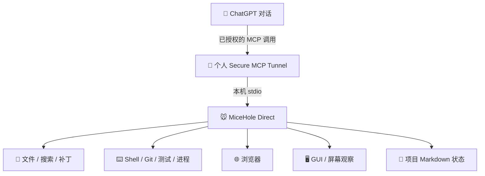

<div align="center">

# 🐭 MiceHole V3
### 手机告诉 ChatGPT 要做什么，它在你的 Windows 电脑上真正动手

**远程写代码、运行测试，也能成为检查 VS Code 作业的编程老师。**

**ChatGPT 负责决策，MiceHole 是操作 Windows 的“手”。** 复用已获授权的 ChatGPT 对话模型，无需额外对接编码大模型 API；实际可用工具、模型及额度均取决于账号权限。

[](https://github.com/ndshuge/micehole/releases/tag/v3.0.1)
[](docs/INSTALL-V3.zh-CN.md)
[](docs/ARCHITECTURE-V3.md)
[](LICENSE)

**[⬇ 下载 V3](https://github.com/ndshuge/micehole/releases/tag/v3.0.1)** · **[📖 中文安装](docs/INSTALL-V3.zh-CN.md)** · **[🧩 技术实现](docs/ARCHITECTURE-V3.md)** · **[🕰 开发历程](docs/HISTORY-V3.md)**

</div>

> [!IMPORTANT]
> V3.0.1 已发布为 GitHub 正常 Release，但**不代表朋友电脑的远程高权限、安全隔离和全部 GUI 场景均已完成验收**。本机 MCP 发现、文件操作、独立路径和远程启动授权门控已有开发机测试证据。使用前请先在可丢弃工程中验收。

## 从这里开始

| 你想做什么 | 推荐入口 |
| --- | --- |
| **手机上让 GPT 辅导电脑里的代码** | [VS Code / Python 教学实战](docs/PHONE-VSCODE-TUTOR.zh-CN.md) |
| **下载并验证** | [V3 Windows Release](https://github.com/ndshuge/micehole/releases/tag/v3.0.1) · [中文安装指南](docs/INSTALL-V3.zh-CN.md) |
| **确认能否在自己电脑上用** | [当前验收范围](docs/V3-DIRECT.md) · [安全说明](docs/SECURITY.md) |
| **理解执行链路** | [技术架构](docs/ARCHITECTURE-V3.md) · [为什么做 MiceHole](docs/WHY-MICEHOLE.md) |
| **追踪项目进度** | [更新日志](CHANGELOG.md) · [开发故事](docs/HISTORY-V3.md) · [MD 工作习惯](docs/MD-HABITS.md) |

> 这不是官方 Codex，也不会增加 ChatGPT 额度；远程高权限需要电脑主人主动授权。请先在可丢弃的工程中测试，再进行实际施工。

## 核心卖点：ChatGPT 对话模式 + 远程本机施工

普通 ChatGPT 对话不能任意直接读取、写入或执行你电脑上的文件和命令。**MiceHole 通过用户主动授权的 MCP 工具与个人 Secure MCP Tunnel，把这些本机操作作为工具能力接入聊天**：你在手机或网页发一句话，电脑端可以按工具请求创建项目、编辑代码、运行测试，再把真实结果返回给 ChatGPT。

- **直接使用 ChatGPT 对话模型，而不是额外调用模型 API**：在账号实际允许的情况下，可以使用 GPT-6 Sol 等高能力对话模型承担编码与推理。适用模型、套餐、额度、MCP/Tunnel 权限以及可能费用都以实际服务为准；不能承诺所有免费账号都有相同能力。
- **远程而不需要公网固定 IP**：由个人 Tunnel 接入本机 stdio MCP，避免公开无认证的 Windows 命令端口。
- **真正的工程闭环**：不是只发代码文本，而是 ChatGPT → 读写代码 → 执行 Python/PowerShell → 获取测试结果 → 修复。
- **不绕过 OpenAI 账户安全规则**：仅在用户账户支持自定义 MCP，并由电脑主人明确授权的情况下使用；这扩展了普通聊天的能力，不是破解 OpenAI 的工具限制或免费解锁官方 Codex。

**一句话定位：用 ChatGPT 对话模式驱动本机远程编程，不再为每次施工额外接一个编码模型 API——实现类似远程 Codex 的工作流。**
## 手机里的 ChatGPT，也能检查电脑上 VS Code 的真实作业

你可以在手机里说：

> 请做我的 Python 老师。用 MiceHole **只读检查**我指定的作业文件，先出一道题，不要替我改。等我在电脑上用 VS Code 改完，运行指定程序，读取真实报错和输出，再逐步批改并出一题变式。

**工作方式：** 手机 ChatGPT 发问 → 用户授权 MCP → 电脑读取指定项目 → GPT 出题和讲解 → 学生在 VS Code 亲自修改 → 经许可运行 Python → 根据真实测试结果批改。一般无需“控制 VS Code 窗口”：通过文件与命令操作相同的项目目录更稳定；GUI 前台操作则需要额外授权和安全条件。

除了学习编程，还适合手机远程维护小型网页、读取日志排查问题、审查 Git 改动以及根据项目 Markdown 状态恢复工作。MiceHole 是工具桥，不是另一个 Agent，也不会增加 ChatGPT/Codex 额度。

**[查看完整手机 × VS Code 教学实例、可复制提示词与验收清单](docs/PHONE-VSCODE-TUTOR.zh-CN.md)**

> **版本边界：** 上述为在设备、账号与权限满足条件下的使用流程，不代表所有用户的手机端远程高权限均已验收。GitHub v3.0.1 Release 仍以 12 项工具及其公开说明为准；开发机实验性浏览器隔离、GUI V6 和 3D 专用工具不能视为 Release 已交付。

## 一张图看懂它



**ChatGPT 是主要决策者；MiceHole 是工具执行桥。** 用户在聊天里提出任务，ChatGPT 根据工具返回结果逐步读文件、修改、运行测试、观察和修正；实际操作发生在用户自己的 Windows 电脑中。无需为 MiceHole 额外部署一个同等规模的编码模型。

## 主要特色

| 常见困扰 | MiceHole 设计目标 |
|---|---|
| AI 给出代码，但要人手动复制粘贴 | 已授权的工具可直接创建、修改、检索文件 |
| 每次都要粘贴终端输出与截图 | 使用命令、测试结果与浏览器/屏幕观察反馈 |
| 长任务和新对话容易失去进度 | 短会话配合 PROJECT.md / STATUS.md / TODO.md / LOG.md |
| 只能坐在电脑前逐步操作 | 有权限的 ChatGPT 客户端可经个人 Tunnel 控制本机 |
| 原作者磁盘、账号、代理配置难复制 | 工作区、用户名、Tunnel 身份和凭据逐人独立配置 |

## 12 项工具，一套执行接口

| 类别 | MCP 工具 | 主要用途 |
|---|---|---|
| 状态 | `status` | 运行状态与诊断 |
| 文件 | `read` / `write` / `patch` / `search` | 搜索、创建、读取、替换文件 |
| 工程 | `run` / `validate` / `process` / `git` | 命令、测试、进程与版本管理 |
| 浏览器 | `browser` | 结构化浏览器交互 |
| 视觉 | `observe` | 截图、窗口与图像观察 |
| GUI | `gui` | 经明确前台授权的鼠标键盘操作 |

工具全名以 `mouse_hole_` 开头。V3 **不包含 Godot、Blender、ComfyUI 的专用接口**。

## Windows 三步开始

从 [v3.0.1 Release](https://github.com/ndshuge/micehole/releases/tag/v3.0.1) 下载 Windows ZIP 与 SHA256 清单，校验后解压至任意自己有权限的目录（不需要作者的 E 盘），并安装 Node.js。

```powershell
# 在 ZIP 解压后的目录执行
powershell -NoProfile -File .\setup-friend.ps1
powershell -NoProfile -File .\scripts\friend-doctor.ps1
```

Doctor 应返回 `local_ready: true` 和 `tools_count: 12`。本地 stdio MCP 入口是 `micehole-direct.cmd`。远程连接 ChatGPT 还需配置**本人**的 OpenAI Platform Tunnel、运行密钥与 ChatGPT 私人 MCP 插件，并明确同意远程高权限。详见 [完整中文安装](docs/INSTALL-V3.zh-CN.md)。

## 在聊天里完成一次“类远程 Codex”工作流

> 在我指定的测试项目中审查代码，先列计划，再修改网页、运行测试、定位错误并修复。每完成一阶段更新 STATUS.md，最后附上测试结果和仍未解决的问题。遇到权限扩大、系统设置或私人文件时先询问我。

这描述的是**自然语言 → 真实电脑操作 → 测试 → 反馈 → 再修复**的体验目标，并不等于 Codex 的完整产品、托管环境、沙箱或无限额度。ChatGPT 账号权限、调用限制以及 Tunnel 使用条件仍然适用。

## 开发历程：我们为什么这样设计？

- **9 月**：OpenHanako 原型，探索 ChatGPT、Transport、Runtime 与真正执行器的关系。
- **9 月底–10 月初**：逐步验证 MCP Tunnel、本机 stdio、项目 Markdown 状态与短会话续接。
- **10 月上旬**：从复杂队列转向直接工具施工，优先 CLI/API/结构化浏览器，降低 GUI 焦点冲突。
- **10 月 10 日**：v0.1.0 有限文件远程 Beta，积累 Windows 安装、Worker 隔离原型和 CI 经验。
- **10 月 13–15 日**：移植当前 Direct 核心，移除三个专用接口，修复个人路径，补充 12 工具与远程授权门控，发布 v3.0.0。

[阅读详细开发故事 →](docs/HISTORY-V3.md)

## 技术与安全事实

> [!CAUTION]
> 高权限入口经用户在本机明确启用后，可用 Windows 当前用户权限执行命令、控制 GUI 和浏览器。**工作区范围不是命令沙箱**，而且同一用户下的执行进程可能接触 Tunnel DPAPI 密钥；独立凭据隔离仍未验收。不要公开无认证命令端口，不要管理员运行。请只使用个人私有认证 Tunnel。

已验证：开发机 MCP 握手、12 项工具注册、删除三个专用入口、文件操作、独立目录、含空格路径迁移、未经授权拒绝远程启动与授权后工具发现。

尚未验证：朋友的真实 ChatGPT/Windows 账号配对、完整远程高权限执行、GUI/浏览器全场景、独立凭据隔离、断线重连和更新回滚。

## v3.0.1：朋友安装、手动更新与诊断

`main` 分支增加了更轻量的项目 MD 接续规范：ChatGPT 按需读取规则、在重要里程碑主动保存检查点，普通测试进程不再自动覆写项目进度；无变化时跳过重复写入。**MiceHole 仍只是 ChatGPT 的手，不包含第二个 Agent。**

这些改进已包含在 **v3.0.1 新 ZIP** 中；旧版 v3.0.0 安装包不会自动升级。详情与测试限制见 [MD 工作习惯与修复说明](docs/MD-HABITS.md)。

## 网络故障诊断（2026-10-17 源码更新）

ChatGPT 突然连不上 MiceHole？**先检查代理、网络和 Tunnel，再决定是否重启**。本次为 V3 Direct 新增可选的、只读的 `scripts/network-doctor.ps1`：能识别本地代理端口是否监听、一般 HTTPS 与 OpenAI API 基础连通性，并报告下一步排查方向。支持自己的 Clash/Mihomo HTTP/Mixed 代理，但**不需要开启 Windows 系统代理**，也不会自动改 DNS 或机场节点。

[给朋友看的更新说明](docs/RELEASE_NOTES_NETWORK_2026-10-17.md) · [使用方法与局限](docs/NETWORK-RELIABILITY.zh-CN.md)

> 请注意：代理节点自动故障转移需由用户已有的 Clash/Mihomo `fallback` 自行配置。诊断不能直接确定机场流量是否耗尽，也不能证明 ChatGPT 远程 MCP 已成功连接。**本轮是源码更新，现有 v3.0.0 ZIP 尚未更新**。


**v3.0.1 安装与更新入口：** [新版说明](docs/RELEASE_NOTES_v3.0.1.zh-CN.md) · [朋友首次安装](direct/START-HERE.zh-CN.md) · [手动更新和回滚](direct/MANUAL-UPDATE.zh-CN.md)。

## 文档导航

| 想了解什么 | 从这里开始 |
|---|---|
| 手机远程 VS Code 项目、Python 教学、作业批改 | [手机编程老师完整指南](docs/PHONE-VSCODE-TUTOR.zh-CN.md) |
| 背景、优势、与 Codex 的差别 | [为什么做 MiceHole](docs/WHY-MICEHOLE.md) |
| 新手从零安装、电脑/ChatGPT 两端步骤 | [Windows 详细安装指南](docs/INSTALL-V3.zh-CN.md) |
| MCP、Tunnel、stdio、执行链路 | [技术架构](docs/ARCHITECTURE-V3.md) |
| 对话中的设计取舍、踩坑、版本历史 | [开发历程](docs/HISTORY-V3.md) |
| 更底层的历史测试记录 | [开发日志](docs/DEVLOG.md) |
| 跨会话续工、什么时候读写 MD、进程污染修复 | [MD 工作习惯](docs/MD-HABITS.md) |
| 当前验收细节与限制 | [V3 现状](docs/V3-DIRECT.md) |
| GitHub 发布文件 | [下载 v3.0.0](https://github.com/ndshuge/micehole/releases/tag/v3.0.1) |

---

<div align="center"><sub>独立开源社区项目 · 与 OpenAI / Codex 无官方关联 · 本机执行和高权限授权由用户自行管理</sub></div>


## 后台优先 GUI（2026-10-18）

默认不抢鼠标、键盘和前台焦点；保留适配的后台原生控件点击，可选指定窗口后台截图；四象限改为手动开启。针对需要前台的动作新增双重授权和输入互斥；自绘软件、最小化窗口不保证兼容。详见 [功能、使用方法及限制](docs/BACKGROUND-GUI-2026-10-18.zh-CN.md)。

后台 GUI 兼容性新验收：[TeleAgent 不抢焦点窗口捕获与 UIA 安全最小化实验](docs/TELEAGENT_BACKGROUND_EVIDENCE_2026-10-18.zh-CN.md)（2026-10-18；仅部分能力通过）。
