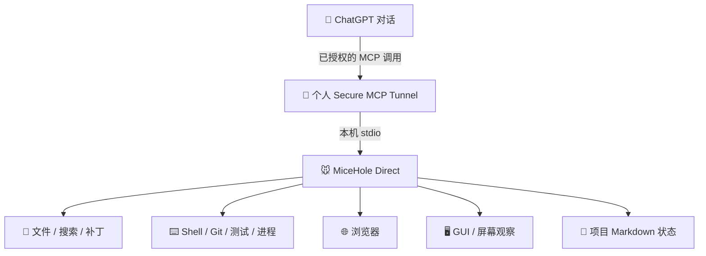

<div align="center">

# 🐭 MiceHole V3
### 让 ChatGPT 从“给建议”走向“在你授权的 Windows 电脑上真正做事”

**ChatGPT × MCP × Secure Tunnel × Windows**

[](https://github.com/ndshuge/micehole/releases/tag/v3.0.0)
[](docs/INSTALL-V3.zh-CN.md)
[](docs/ARCHITECTURE-V3.md)
[](LICENSE)

**[⬇ 下载 V3](https://github.com/ndshuge/micehole/releases/tag/v3.0.0)** · **[📖 中文安装](docs/INSTALL-V3.zh-CN.md)** · **[🧩 技术实现](docs/ARCHITECTURE-V3.md)** · **[🕰 开发历程](docs/HISTORY-V3.md)**

</div>

> [!IMPORTANT]
> V3.0.0 已发布为 GitHub 正常 Release，但**不代表朋友电脑的远程高权限、安全隔离和全部 GUI 场景均已完成验收**。本机 MCP 发现、文件操作、独立路径和远程启动授权门控已有开发机测试证据。使用前请先在可丢弃工程中验收。

## 一张图看懂它



**ChatGPT 是主要决策者；MiceHole 是工具执行桥。** 用户在聊天里提出任务，ChatGPT 根据工具返回结果逐步读文件、修改、运行测试、观察和修正；实际操作发生在用户自己的 Windows 电脑中。无需为 MiceHole 额外部署一个同等规模的编码模型。

## 主要特色

| 常见困扰 | MiceHole 设计目标 |
|---|---|
| AI 给出代码，但要人手动复制粘贴 | 已授权的工具可直接创建、修改、检索文件 |
| 每次都要粘贴终端输出与截图 | 使用命令、测试结果与浏览器/屏幕观察反馈 |
| 长任务和新对话容易失去进度 | 短会话配合 PROJECT.md / STATUS.md / TODO.md / LOG.md |
| 只能坐在电脑前逐步操作 | 有权限的 ChatGPT 客户端可经个人 Tunnel 控制本机 |
| 原作者磁盘、账号、代理配置难复制 | 工作区、用户名、Tunnel 身份和凭据逐人独立配置 |

## 12 项工具，一套执行接口

| 类别 | MCP 工具 | 主要用途 |
|---|---|---|
| 状态 | `status` | 运行状态与诊断 |
| 文件 | `read` / `write` / `patch` / `search` | 搜索、创建、读取、替换文件 |
| 工程 | `run` / `validate` / `process` / `git` | 命令、测试、进程与版本管理 |
| 浏览器 | `browser` | 结构化浏览器交互 |
| 视觉 | `observe` | 截图、窗口与图像观察 |
| GUI | `gui` | 经明确前台授权的鼠标键盘操作 |

工具全名以 `mouse_hole_` 开头。V3 **不包含 Godot、Blender、ComfyUI 的专用接口**。

## Windows 三步开始

从 [v3.0.0 Release](https://github.com/ndshuge/micehole/releases/tag/v3.0.0) 下载 Windows ZIP 与 SHA256 清单，校验后解压至任意自己有权限的目录（不需要作者的 E 盘），并安装 Node.js。

```powershell
# 在 ZIP 解压后的目录执行
powershell -NoProfile -File .\setup-friend.ps1
powershell -NoProfile -File .\scripts\friend-doctor.ps1
```

Doctor 应返回 `local_ready: true` 和 `tools_count: 12`。本地 stdio MCP 入口是 `micehole-direct.cmd`。远程连接 ChatGPT 还需配置**本人**的 OpenAI Platform Tunnel、运行密钥与 ChatGPT 私人 MCP 插件，并明确同意远程高权限。详见 [完整中文安装](docs/INSTALL-V3.zh-CN.md)。

## 在聊天里完成一次“类远程 Codex”工作流

> 在我指定的测试项目中审查代码，先列计划，再修改网页、运行测试、定位错误并修复。每完成一阶段更新 STATUS.md，最后附上测试结果和仍未解决的问题。遇到权限扩大、系统设置或私人文件时先询问我。

这描述的是**自然语言 → 真实电脑操作 → 测试 → 反馈 → 再修复**的体验目标，并不等于 Codex 的完整产品、托管环境、沙箱或无限额度。ChatGPT 账号权限、调用限制以及 Tunnel 使用条件仍然适用。

## 开发历程：我们为什么这样设计？

- **9 月**：OpenHanako 原型，探索 ChatGPT、Transport、Runtime 与真正执行器的关系。
- **9 月底–10 月初**：逐步验证 MCP Tunnel、本机 stdio、项目 Markdown 状态与短会话续接。
- **10 月上旬**：从复杂队列转向直接工具施工，优先 CLI/API/结构化浏览器，降低 GUI 焦点冲突。
- **10 月 10 日**：v0.1.0 有限文件远程 Beta，积累 Windows 安装、Worker 隔离原型和 CI 经验。
- **10 月 13–15 日**：移植当前 Direct 核心，移除三个专用接口，修复个人路径，补充 12 工具与远程授权门控，发布 v3.0.0。

[阅读详细开发故事 →](docs/HISTORY-V3.md)

## 技术与安全事实

> [!CAUTION]
> 高权限入口经用户在本机明确启用后，可用 Windows 当前用户权限执行命令、控制 GUI 和浏览器。**工作区范围不是命令沙箱**，而且同一用户下的执行进程可能接触 Tunnel DPAPI 密钥；独立凭据隔离仍未验收。不要公开无认证命令端口，不要管理员运行。请只使用个人私有认证 Tunnel。

已验证：开发机 MCP 握手、12 项工具注册、删除三个专用入口、文件操作、独立目录、含空格路径迁移、未经授权拒绝远程启动与授权后工具发现。

尚未验证：朋友的真实 ChatGPT/Windows 账号配对、完整远程高权限执行、GUI/浏览器全场景、独立凭据隔离、断线重连和更新回滚。

## 文档导航

| 想了解什么 | 从这里开始 |
|---|---|
| 背景、优势、与 Codex 的差别 | [为什么做 MiceHole](docs/WHY-MICEHOLE.md) |
| 新手从零安装、电脑/ChatGPT 两端步骤 | [Windows 详细安装指南](docs/INSTALL-V3.zh-CN.md) |
| MCP、Tunnel、stdio、执行链路 | [技术架构](docs/ARCHITECTURE-V3.md) |
| 对话中的设计取舍、踩坑、版本历史 | [开发历程](docs/HISTORY-V3.md) |
| 更底层的历史测试记录 | [开发日志](docs/DEVLOG.md) |
| 当前验收细节与限制 | [V3 现状](docs/V3-DIRECT.md) |
| GitHub 发布文件 | [下载 v3.0.0](https://github.com/ndshuge/micehole/releases/tag/v3.0.0) |

---

<div align="center"><sub>独立开源社区项目 · 与 OpenAI / Codex 无官方关联 · 本机执行和高权限授权由用户自行管理</sub></div>
