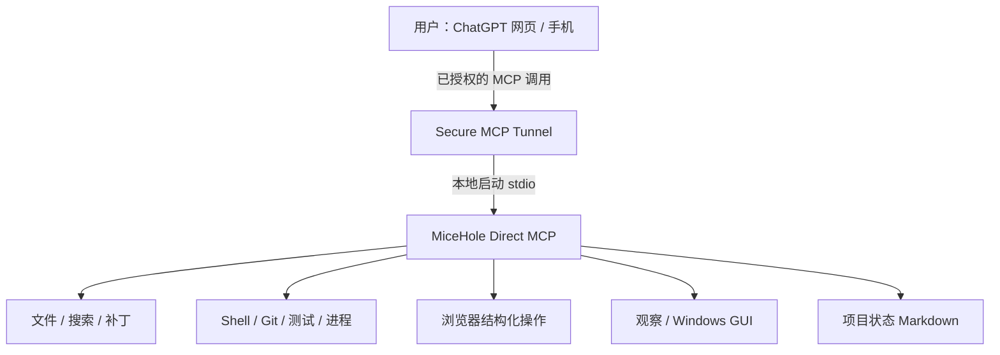
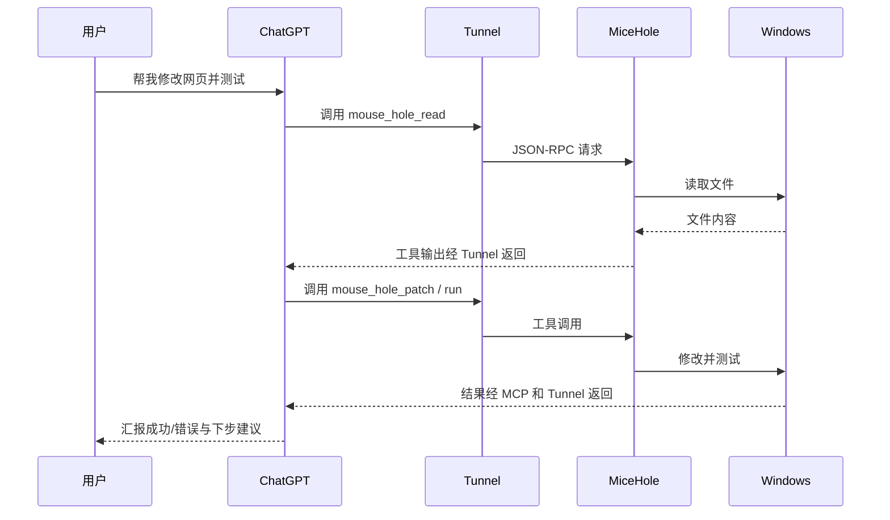

# MiceHole 技术架构：如何用 ChatGPT 操作 Windows？

## 数据流

MCP（Model Context Protocol）负责向模型描述可用工具及参数；本机 stdio 使用标准输入/输出交换 JSON-RPC 消息。Tunnel 将经过授权的 ChatGPT 工具调用送达朋友自己的电脑，而不是必须将本机命令服务直接裸露在公网。公网 IP 与用户安装路径不同，不要求修改 MiceHole 源码。

## 一次任务的真实流程

## 12 项工具

| 类别 | 工具 | 用途 |
|---|---|---|
| 状态 | status | 检查服务、运行状态与诊断 |
| 文件 | read / write / patch / search | 搜索、读取、创建与定点修改文件 |
| 工程 | run / validate / process / git | 命令执行、验证、持久进程和 Git 状态 |
| 浏览器 | browser | 尽量利用 DOM/结构化自动化，必要时转前台 |
| 视觉 | observe | 观察窗口、屏幕或图像 |
| GUI | gui | 经前台授权点击、输入与控制窗口 |

全部工具名带 `mouse_hole_` 前缀。V3 不提供 Blender、Godot、ComfyUI 专用入口。

## 执行引擎与聊天模型的分工

**ChatGPT 主要负责理解、规划与纠错；MiceHole 负责调用真实电脑资源。** 这就是无需在每台朋友电脑上再训练一个大型编码神经网络也能工作的原因。无独立 MiceHole 模型 API 不等于没有 ChatGPT、Platform/Tunnel 或设备成本；也不代表拥有无限调用额度。

**工程连续性**：将目标、任务和进度写入 PROJECT.md、TODO.md、STATUS.md、LOG.md。短会话可以依据这些记录恢复方向，但仍需重新检查当前文件与进程的真实状态；不能把 Markdown 当作权威实时进程列表。

**GUI 实际限制**：一个 Windows 交互桌面存在焦点争用。GUI 四象限布置有助于减少遮挡，但不能创造四个完全独立的输入焦点。优先用命令行、API、结构化浏览器，确实必要时再接管桌面。

## 可移植配置与风险边界

| 参数 | 归属 |
|---|---|
| 工作区 | 朋友个人的 MOUSE_HOLE_WORKSPACE / 本地配置 |
| 安装盘符、用户名、代理 | 朋友电脑，不依赖作者固定路径 |
| Tunnel ID、运行密钥 | 朋友自己的 OpenAI Platform 账号 |
| ChatGPT MCP 插件 | 朋友自己的 ChatGPT 账号与授权 |
| 浏览器、Python 等可选依赖 | 目标电脑上独立检测 |

> [!CAUTION]
> 远程高权限意味着可以使用 Windows 登录用户的 Shell、GUI 和浏览器能力。文件工具的工作区限制不是命令沙箱；同一 Windows 用户运行的执行进程可能接触该用户的 Tunnel DPAPI 密钥。独立进程/凭据隔离仍未验收。不要开放无认证公网命令入口，不要以管理员身份运行。

[首页](../README.md) · [安装手册](INSTALL-V3.zh-CN.md)