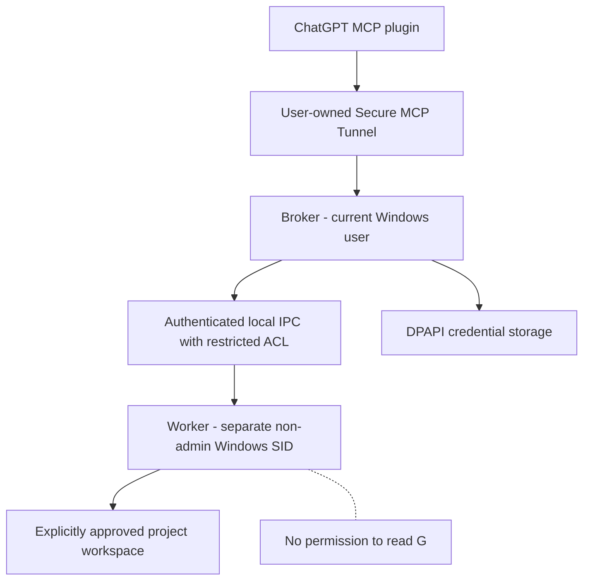

# Isolated coding worker — security implementation contract

**Status:** Architecture and acceptance criteria; NOT implemented in the public Preview.

## Why this is a release blocker

Personal Secure MCP Tunnel needs a runtime credential. In the current preview that credential
is stored encrypted with the signed-in Windows user's DPAPI CurrentUser. If arbitrary AI-invoked
PowerShell/Node programs run under that **same Windows user**, they can potentially recover the
runtime credential or access other private files. Clearing environment variables is helpful but
does **not** establish a security boundary. A Windows Job Object by itself also does not change
the worker identity or file permissions.

MiceHole's private-Tunnel launcher intentionally exposes **only five tools** (status,
read, write, patch, search), and denies remote shell, build/validation, processes and Git subprocesses.
Do not unlock these until the following identity separation can be proven.

## Proposed architecture

The **Broker** owns only Tunnel authentication, user consent, task routing and bound output.
The **Worker** owns compilation, test execution, interactive shell/process jobs and project
artifacts. The Worker must not inherit `CONTROL_PLANE_API_KEY`, model API keys, profile paths,
or the user's other application credentials.

## Required properties (P0; fail closed)

1. **Different user SIDs:** Broker SID and Worker SID must differ and the Worker must be a
   genuine low-privilege Windows logon, not a child of the same logon with only a different
   environment or working directory.
2. **Credential ACL:** the worker token must receive Access Denied when attempting to read the
   Broker's `runtime-key.dpapi`, Tunnel profile settings and protected pipe endpoint. Test the
   access denial by actually running code *as the worker SID*, not by merely inspecting ACLs.
3. **No secret inheritance:** verify the worker cannot see Tunnel runtime/model keys in its
   environment, command line, inherited handles, temp files or readable broker process memory.
4. **Workspace ACL:** worker can read/write only a user-approved project root and the minimal
   compiler/runtime locations; no inherited write permission to the Broker install/config
   directories. Treat arbitrary build scripts and Git hooks as untrusted.
5. **Local authenticated IPC:** broker must authenticate the real client process/token; a
   caller-provided SID field is insufficient. Restrict pipe access with an explicit DACL.
6. **Process tree containment:** each job uses bounded output, resource limits, cancellation,
   and Windows Job Object kill-on-close to avoid orphan grandchildren.
7. **Opt-in provisioning:** creating a user, assigning ACLs or storing a scheduled-task worker
   identity requires visible consent and rollback. None of those actions are allowed during the
   non-reboot/low-risk phase.
8. **No fallback:** if the Worker account disappears, IPC is denied or security checks fail,
   the tool must return a clear error — NEVER execute the command inside the privileged
   Broker as an automatic fallback.

## Non-reboot test plan (does not create OS accounts)

- [x] Keep remote command invocation locked independently of `executionEnabled`.
- [x] Remote tool discovery advertises only the five file/status tools.
- [x] Negative workspace/file alias and search traversal tests.
- [x] Develop the Broker↔Worker IPC prototype with fake tokens / synthetic identities
      **in an offline, unprivileged fixture**. Node named-pipe transport tested:
      sanitized mock environment, request frames, fake authentication, malformed
      messages, and refusal of execute/process/git/validate, including forged
      client-provided attestation. It does **not** prove OS isolation or authenticate
      a Windows client SID. The prototype is CI-only and explicitly EXCLUDED from
      downloadable public releases; the remote MCP tool list remains five tools.
- [x] Prove real Windows named-pipe peer identity can be read through
      `NamedPipeServerStream.RunAsClient` / `WindowsIdentity.GetCurrent(true)`.
      Same-user negative control passed on the author's Windows session without creating
      users or changing ACLs. This tests the kernel-backed SID observation primitive,
      **not** a distinct-SID worker or pipe DACL.
- [ ] Validate a worker installer provisioning/rollback plan on a throwaway Windows account or VM.
- [ ] Run a real distinct-SID worker and prove Access Denied to the DPAPI key/other home data. A dedicated GitHub-hosted Windows experiment now tests this with the built-in **LocalService SID** and an isolated dummy credential, rather than creating a user on the owner's machine. Its results must be confirmed before checking this item; a full production Worker remains separate.
      This is an authorized OS-level mutation, deferred past the present safety gate.

## Post-pre-reboot steps

After a reviewed separate-identity design and explicit approval:

1. Provision a dedicated non-admin Windows identity (no reuse of the user's personal password),
   and grant project-only NTFS permissions.
2. Configure a dedicated worker entrypoint and an authenticated local IPC channel.
3. Run negative ACL/secret tests *as that worker*, then demonstrate a small compile/test task.
4. Enable remote command tools only behind a positive identity/ACL attestation and explicit
   per-workspace approval.
5. Separately test user logon / reboot / sleep-wake / proxy recovery and full uninstall rollback.

**Windows reboot alone does not fix credential isolation.** Do not represent the preview as a
full remote Codex-style coding agent while remote commands remain locked.
